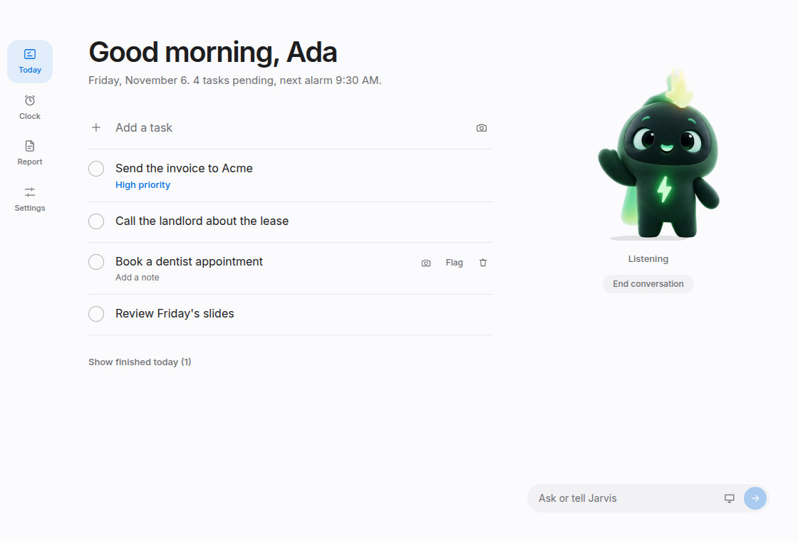
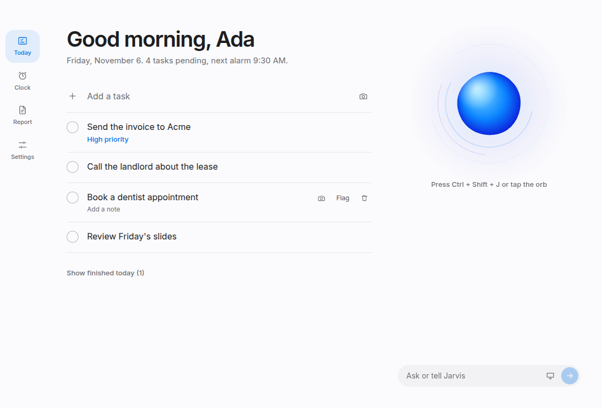
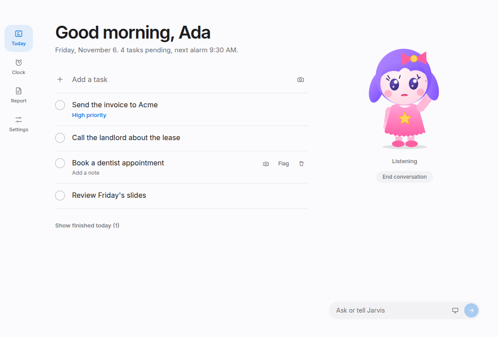
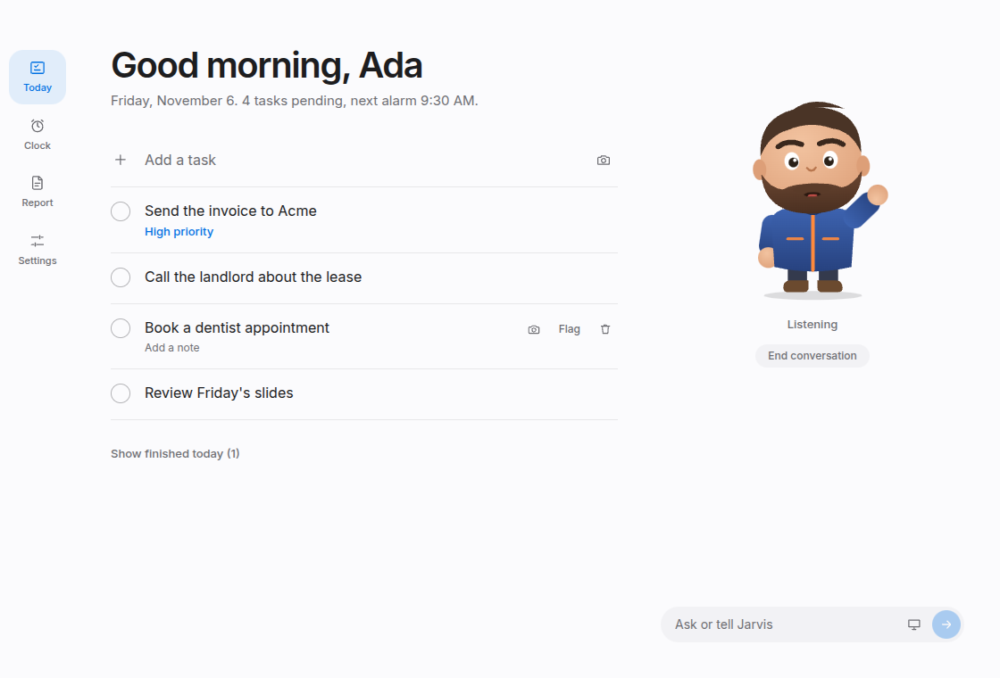

<div align="center">

# Jarvis Desk

**A voice-first desktop assistant that lives on your computer.**
Tasks, alarms, screenshots and a daily report, run by talking. Bring your own AI key.

[](https://github.com/yehhmii/buddy-desk/actions/workflows/ci.yml)
[](LICENSE)




</div>

## What is it?

Jarvis Desk sits quietly in your system tray. Say **"Hey Jarvis"** (or press a shortcut) and a small character appears at the bottom of your screen. Ask it things, and keep talking until you say "goodbye":

> "Add call the landlord to my tasks, high priority."
> "Wake me at 6:30 tomorrow."
> "Take a screenshot and add it to the invoice task. Note: check the totals."
> "What's pending?"

At the end of the day it writes a short report of what you finished and what is still open, and, if you are at your computer, offers to read it to you.

It is private by design. Your tasks, screenshots and settings stay on your computer. Your AI key stays on your computer too, encrypted. The only things that leave are the requests you make to the AI service you chose.

## Features

- **Hands-free voice.** A wake word you can change, and conversations that continue until you end them.
- **Tasks** with notes, priorities, due dates and screenshots. Add, edit, complete and remove by voice or by clicking.
- **Alarms and timers** that keep running when the window is closed. On Windows they can even wake a sleeping PC.
- **Screenshots on tasks.** Say it, or click the camera. The image is saved and attached.
- **Screen reading.** Ask "what's on my screen?" Text is read on your computer, and passwords, keys and card numbers are removed before anything is sent.
- **Daily report** written automatically, exportable as PDF, with an offer to read it aloud.
- **Pick your AI.** Groq and Google Gemini have free tiers. OpenAI (ChatGPT API) and Anthropic (Claude API) work too. Jarvis switches provider on its own if one is busy.
- **Pick a character.** An orb in any colour, or Buddy, Luna or Rex. You can add your own ([how](docs/ADDING_SKINS.md)).
- **Privacy controls.** Hide the window from screen sharing, hide what Jarvis hears and says in the floating window, and redact secrets from screen text.
- **Works offline for voice, if you want.** A small on-device model handles the wake word, and basic speech recognition when no cloud speech key is set.

<p align="center">
  
  
  
</p>

## Install (no technical knowledge needed)

1. Go to the **[Releases page](https://github.com/yehhmii/buddy-desk/releases/latest)** and download the file for your computer:
   - **Windows 10/11:** `Buddy-Desk-Setup.exe`
   - **Mac with Apple silicon (M1 or newer):** `Buddy-Desk-mac-arm64.dmg`
   - **Mac with an Intel chip:** `Buddy-Desk-mac-x64.dmg`
2. Open it and follow the installer. On a Mac, drag Jarvis Desk into Applications.
3. Start Jarvis Desk. A short guide walks you through the rest.

> **If Windows or macOS warns you** ("Windows protected your PC", or "cannot be opened because the developer cannot be verified"): that happens for apps from small projects that are not code-signed yet. On Windows click **More info, then Run anyway**. On a Mac, right-click the app, choose **Open**, then **Open** again. The code is public, so you can read exactly what it does.

### Your first two minutes

The first-run guide asks for four things:

1. **Your name**, so Jarvis can greet you.
2. **An AI key.** This is the one thing you need to supply. See below.
3. **A character.**
4. **Voice.** Allow the microphone. Optionally download the small voice model (about 40 MB) for the hands-free wake word.

You never have to edit a file: everything, including your keys, is set inside the app under **Settings**. Click **Test** next to a key to check it works.

## Getting an AI key

Jarvis needs **one** key to think. Pick whichever you like. All of them are pasted into **Settings > AI providers**.

| Provider                   | Cost          | Get a key                                                                          | Notes                                                             |
| -------------------------- | ------------- | ---------------------------------------------------------------------------------- | ----------------------------------------------------------------- |
| **Groq**                   | Free tier     | [console.groq.com/keys](https://console.groq.com/keys)                             | Fast. Also gives accurate voice recognition. Best place to start. |
| **Google Gemini**          | Free tier     | [aistudio.google.com/apikey](https://aistudio.google.com/apikey)                   | Can also look at screenshots.                                     |
| **OpenAI (ChatGPT API)**   | Pay as you go | [platform.openai.com/api-keys](https://platform.openai.com/api-keys)               | See the note below.                                               |
| **Anthropic (Claude API)** | Pay as you go | [console.anthropic.com/settings/keys](https://console.anthropic.com/settings/keys) | See the note below.                                               |

> **A ChatGPT or Claude subscription is not an API key.** The chat apps you pay a monthly fee for (ChatGPT Plus, Claude Pro) are separate products from the API. To use OpenAI or Claude here, create an account at the links above, add a small amount of credit, and make a key. Usage is billed per request and a casual user typically spends very little.
>
> Free tiers have limits and the providers change them from time to time. If one runs out, Jarvis switches to another key if you have added it.

**Voice and Claude:** Claude has no speech-to-text service. If you only add a Claude key, you can still type to Jarvis, and Jarvis still speaks its replies. For voice input, also add a free Groq key, or download the offline voice model in Settings. The offline model needs no key and no internet, but its accuracy is basic compared with the cloud services.

## Using it

| To...                                      | Do this                                                                                        |
| ------------------------------------------ | ---------------------------------------------------------------------------------------------- |
| Start talking                              | Say your wake word, press **Ctrl + Shift + J** (change it in Settings), or click the character |
| Keep the conversation going                | Just keep talking after each reply                                                             |
| End the conversation                       | Say "goodbye", "that's all", or "stop listening", or wait a few seconds                        |
| Bring Jarvis back after closing the window | Click the tray icon (bottom right; on Mac, the menu bar), or say "open Jarvis"                 |
| Change anything                            | Settings: character, colour, voice, wake word, keys, privacy, report time                      |

Closing the window only hides it. Jarvis keeps listening from the tray. To quit completely, use the tray menu.

## Privacy

- **Stays on your computer:** tasks, notes, alarms, screenshots, reports, settings, and your API keys (encrypted with Windows or macOS system security).
- **Sent to the AI service you chose:** what you say or type (as text), your current task list so it can answer, and, only when you ask, text read from your screen. Screenshots are never sent unless you ask a question about what is visually on the screen, and you can switch that off.
- **Speech:** audio is sent to a speech service (Groq, OpenAI or Gemini, whichever you have a key for) to be turned into text. The wake word is recognised entirely on your computer. Spoken replies use Microsoft Edge's free text-to-speech service, which receives the text being read.
- **Screen text is cleaned first:** passwords, API keys, tokens and card numbers are removed before it leaves your computer.
- **No accounts, no analytics, no tracking.** Updates are fetched from this project's GitHub releases.

Please read your chosen provider's terms, since free tiers may handle data differently from paid ones.

**Hiding Jarvis:** in Settings > Privacy the window can be hidden from screen sharing and recording, and in Settings > Voice you can stop the floating window from showing what you say and what Jarvis replies. This is a convenience, not a guarantee against every capture tool.

## Run it from source

You need [Node.js](https://nodejs.org) 22 or newer and Git.

```bash
git clone https://github.com/yehhmii/buddy-desk.git
cd buddy-desk
npm install
npm run dev
```

You can add your key in the app. If you prefer a file, copy `.env.example` to `.env` and fill it in.

```bash
npm test            # unit tests
npm run typecheck   # strict TypeScript
npm run format      # Prettier
npm run dist:win    # build the Windows installer (on Windows)
npm run dist:mac    # build the macOS installers (on a Mac)
```

## How it works

```
 You speak ──► wake word (offline) ──► record ──► speech to text ──► AI with tools
                                                                          │
   spoken reply ◄── text to speech ◄── reply ◄── add_task / set_alarm / take_screenshot ...
```

The app has three layers: a sandboxed React interface, a small preload bridge that exposes a short list of named functions, and a Node main process that owns the database, the AI providers and every secret. The pieces are wired together in one place and tested with simple fakes. Read **[docs/ARCHITECTURE.md](docs/ARCHITECTURE.md)** for the tour.

## Project status

Windows is the primary platform. **macOS builds are included and run in continuous integration, but have had less real-world testing**, so expect rough edges and please report them. Some features are Windows-only: waking a sleeping PC for an alarm, and a few capture-hiding behaviours differ on macOS. Linux is not packaged, though most of the code is cross-platform.

Ideas welcome: more characters, more languages for voice, calendar integration, a mobile companion. See the [issues](https://github.com/yehhmii/buddy-desk/issues).

## Contributing

Contributions are welcome, whether code, a new character, a bug report or better wording.

- Read **[CONTRIBUTING.md](CONTRIBUTING.md)**.
- Changes reach `main` only through a pull request that passes CI and is approved by a maintainer. See [docs/REPO_SETUP.md](docs/REPO_SETUP.md) for how the repository is protected.
- Found a security problem? Follow **[SECURITY.md](SECURITY.md)** and do not open a public issue.
- Everyone taking part follows the **[Code of Conduct](CODE_OF_CONDUCT.md)**.

Maintainers: how to publish a release is in [docs/RELEASING.md](docs/RELEASING.md).

## Troubleshooting

| Problem                                  | Try this                                                                                                                 |
| ---------------------------------------- | ------------------------------------------------------------------------------------------------------------------------ |
| "No AI provider is set up"               | Settings > AI providers: paste a key and click Test                                                                      |
| Key test says the model is not available | Model names change. Settings > AI providers > Model names, and enter a current one                                       |
| Jarvis does not hear me                  | Allow the microphone in Windows or macOS privacy settings; check Settings > Voice                                        |
| Wake word does nothing                   | Settings > Wake word: download the model first, switch it on, then use Test wake word                                    |
| Alarm did not wake the PC (Windows)      | Power Options > Advanced > Sleep > Allow wake timers must be on; some laptops cannot wake for timers                     |
| Screenshots are blank on a Mac           | System Settings > Privacy & Security > Screen Recording: allow Jarvis Desk, then restart it                              |
| Something else                           | Logs: `%APPDATA%\Jarvis Desk\logs\main.log` on Windows, `~/Library/Logs/Jarvis Desk/main.log` on Mac. Never share a key. |

## Credits

Built with [Electron](https://www.electronjs.org), [React](https://react.dev), [Vosk](https://alphacephei.com/vosk/) for the offline wake word, [Tesseract.js](https://tesseract.projectnaptha.com/) for reading text on screen, and the Groq, Google, OpenAI and Anthropic APIs. Buddy artwork: YOUR_NAME_OR_ARTIST. Luna and Rex are drawn for this project.

## Licence

[MIT](LICENSE). "Jarvis" is a fictional character name; this project is not affiliated with or endorsed by any company.
