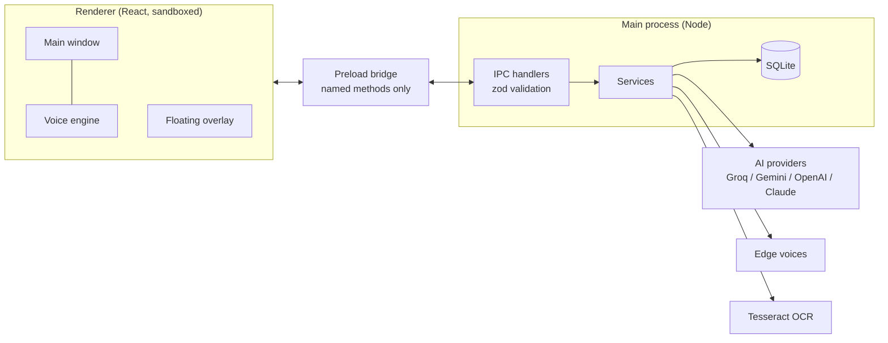
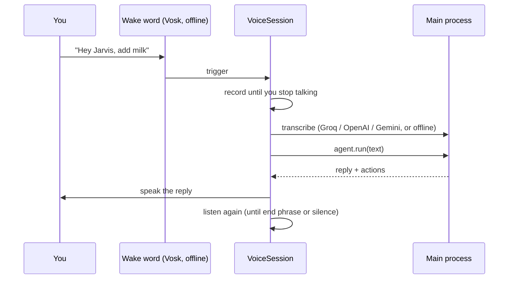

# Architecture

Jarvis Desk is an Electron app written in TypeScript. This page explains how the pieces fit, so you can find your way around quickly.

## The three layers

| Folder         | What lives there                                                              |
| -------------- | ----------------------------------------------------------------------------- |
| `src/main`     | Electron main process: windows, tray, database, all services, IPC handlers    |
| `src/preload`  | The only API the UI can call (`window.api`), built with `contextBridge`       |
| `src/renderer` | React UI. `features/` holds one folder per area (tasks, voice, settings, ...) |
| `src/shared`   | Types, zod schemas, the IPC contract, settings, and pure helpers used by all  |
| `tests`        | Unit tests (vitest)                                                           |
| `config`       | Build-time config such as the Content Security Policy                         |

`src/shared/api.ts` is the contract: if the UI needs something from the main process, it is a method there, implemented in `preload/index.ts`, handled in `main/ipc/registerIpc.ts`, and validated by a schema in `shared/schemas.ts`.

## Main process

`src/main/container.ts` is the composition root. It builds every service from its dependencies, so nothing creates its own collaborators and everything can be tested with fakes.

Services (in `src/main/services`):

- **ai**: `LlmRouter` picks a provider per request and fails over on rate limits or outages. Providers implement one interface: `OpenAICompatProvider` (Groq, Gemini, OpenAI) and `AnthropicProvider` (Claude's native API). `AgentService` runs the tool-calling loop; `ToolExecutor` carries out the tools (`add_task`, `set_alarm`, `take_screenshot`, ...).
- **tasks, alarms**: data and scheduling. `AlarmScheduler` ticks every second; `SleepWakeService` keeps a Windows wake timer pointed at the next alarm.
- **speech**: `SttService` (Groq, OpenAI or Gemini) and `TtsService` (Edge neural voices).
- **screen, screenshot**: capture, local OCR, redaction of secrets, and saving screenshots to tasks.
- **reports**: building the day report, PDF export, the daily scheduler, and `ReportAnnouncer` which waits until you are at the computer.
- **secrets**: API keys encrypted with the OS keychain (Electron `safeStorage`).
- **updates**: auto-update from GitHub Releases.

## The voice loop

The voice engine runs in the main window's renderer, because that is where the microphone and audio playback are. The window is hidden, not closed, when you close it, so the engine keeps running.

`VoiceSession` (`renderer/src/features/voice/VoiceSession.ts`) is the conversation state machine. It is written against small interfaces (microphone, recorder, speech output, gateway) so `tests/voiceSession.test.ts` can simulate whole conversations.

The floating overlay is a separate transparent, click-through window. It has no logic of its own: the engine reports its state to the main process, which relays it to the overlay.

## Characters

`features/voice/Character.tsx` renders whichever skin is chosen: the canvas orb, frame-by-frame sprites (Buddy), or an animated SVG (Luna, Rex). See [ADDING_SKINS.md](ADDING_SKINS.md).

## Data

Everything is stored locally.

| What            | Where                                                             |
| --------------- | ----------------------------------------------------------------- |
| Database        | `buddy.db` in the app data folder (tasks, alarms, settings, keys) |
| Screenshots     | `screenshots/` in the app data folder                             |
| Wake-word model | `models/` in the app data folder                                  |
| Logs            | `logs/main.log`                                                   |

App data folder: `%APPDATA%\Jarvis Desk` on Windows, `~/Library/Application Support/Jarvis Desk` on macOS.

## Security model in one paragraph

The renderer is sandboxed with context isolation and has no Node access. It talks to the main process only through the preload API; each call is checked for a trusted sender and validated with zod. API keys never leave the main process. Text from the screen and replies from models are treated as untrusted: tools that change data act on one item at a time. See [SECURITY.md](../SECURITY.md).
